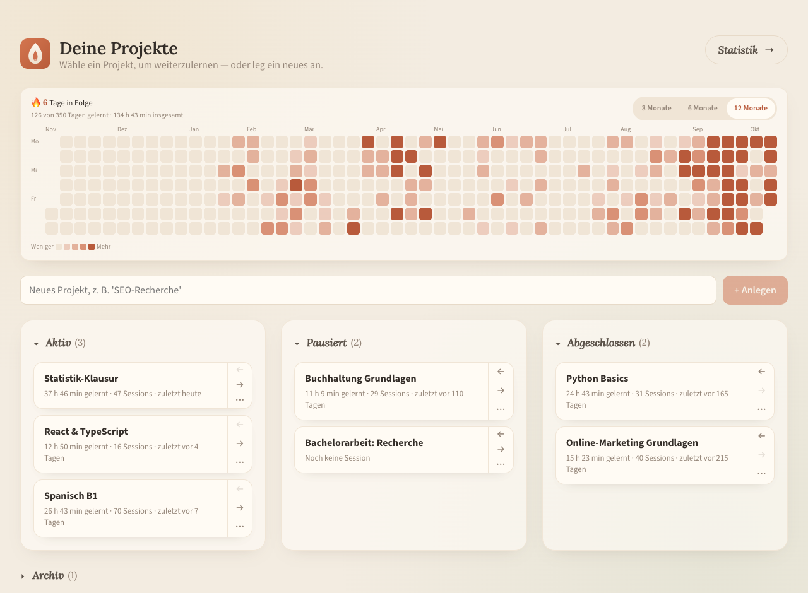
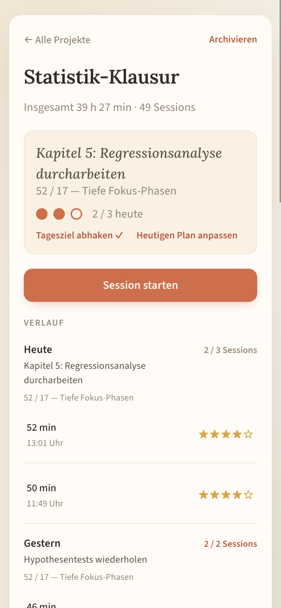
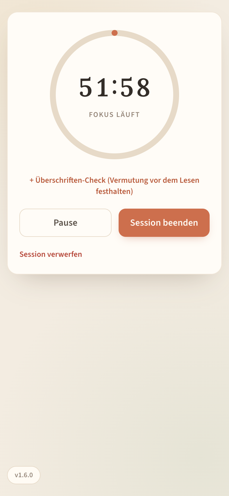
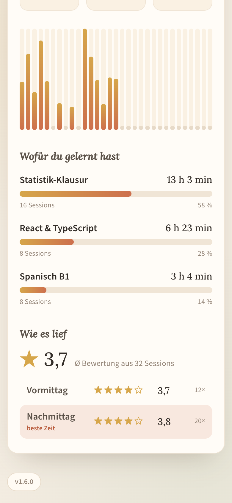

# Lern-PWA

**Lern-Sessions** ist ein selbst gehosteter Lern-Tracker als installierbare Web-App. Pro Lernprojekt planst du deinen Tag, lernst in festen Fokus-Phasen und hältst danach fest, was hängengeblieben ist. Läuft komplett auf eigener Hardware (bei mir ein Raspberry Pi 5), ohne Konto, ohne Tracking, ohne Cloud.



<table>
  <tr>
    <td align="center"><br><sub>Tagesplan und Verlauf</sub></td>
    <td align="center"><br><sub>Fokus-Timer</sub></td>
    <td align="center"><br><sub>Statistik</sub></td>
  </tr>
</table>

<sub>Screenshots mit Demo-Daten.</sub>

## Inhalt

- [Funktionen](#funktionen)
- [Architektur](#architektur)
- [Selbst hosten](#selbst-hosten)
- [Backup und Wiederherstellung](#backup-und-wiederherstellung)
- [Entwicklung](#entwicklung)
- [Releases und Updates](#releases-und-updates)
- [Projektstruktur](#projektstruktur)
- [API](#api)
- [Datenmodell](#datenmodell)
- [Grenzen und Ideen](#grenzen-und-ideen)
- [Lizenz](#lizenz)

## Funktionen

**Planen**
- **Projekt-Board** mit den Spalten Aktiv, Pausiert und Abgeschlossen. Projekte wandern mit ← → zwischen den Spalten; über ⋯ lassen sie sich archivieren oder löschen.
- Spalten lassen sich per Tipp auf die Überschrift einklappen. Die App merkt sich das pro Gerät.
- **Archiv:** Archivierte Projekte verschwinden vom Board, ihre Lernzeit zählt aber weiter in Lernkalender und Statistik. „Wiederherstellen“ bringt sie in ihre alte Spalte zurück.
- **Tagesplan pro Projekt:** Ziel für heute, Zeitsystem und Anzahl geplanter Sessions, mit Fortschrittsanzeige und abhakbar.

**Lernen**
- **Fokus-Timer** mit drei Zeitsystemen: 25/5 (Sprint), 52/17 (Deep Work) oder frei wählbar (5–180 min). Mit Pause/Weiter, Signalton und Browser-Benachrichtigung am Ende. Bei 25/5 und 52/17 startet nach dem Feedback automatisch der Pausen-Timer.
- Der Timer rechnet mit echten Zeitstempeln statt mitgezählten Sekunden. Er bleibt also korrekt, auch wenn der Browser den Tab drosselt oder das Handy schläft.
- **Offene Sessions:** Wird die App mitten in einer Session geschlossen, lässt sich die Session später fortsetzen oder verwerfen.
- **Überschriften-Check:** Während der Session vor dem Lesen eines Abschnitts kurz aufschreiben, was man darunter erwartet.

**Reflektieren**
- **Feedback nach jeder Session:** Active Recall (aus dem Kopf aufschreiben, was hängengeblieben ist), Bewertung von 1–5 Sternen und eine freie Notiz.
- **Verlauf** pro Projekt nach Kalendertag gruppiert, mit Tagesziel, geplant vs. geschafft und Details zu jeder Session.

**Überblick**
- **Lernkalender** im GitHub-Stil mit Lern-Serie in Tagen. Zeitraum per Filter: 3 Monate (Standard), 6 oder 12 Monate. Die Wahl merkt sich die App pro Gerät. Die Felder wachsen mit der verfügbaren Breite.
- **Statistik** nach Woche oder Monat, zum Durchblättern:
  - Fokuszeit pro Tag als Diagramm.
  - „Wofür du gelernt hast“: Lernzeit pro Projekt mit Anteil.
  - „Wie es lief“: Ø Sterne-Bewertung, auch nach Tageszeit.
- Gezählt wird nur aktive Timer-Zeit, also ohne Pausen und gedeckelt auf die geplante Dauer. Wer den Timer nach dem Ende liegen lässt, bekommt das nicht als Lernzeit gutgeschrieben.

**App**
- Als **PWA** auf Handy und Desktop installierbar.
- **Offline:** Ist der Server nicht erreichbar, zeigt die App den zuletzt bekannten Stand.
- **Update-Hinweis:** Sobald eine neue Version auf dem Server liegt, erscheint unten links „Update verfügbar“. Ein Klick auf die Versionsnummer zeigt den Versionsverlauf.

## Architektur

```
Browser / installierte PWA
        │ HTTPS (Tailscale) bzw. http://127.0.0.1:8090
        ▼
┌───────────────────────────┐     ┌─────────────────────────────┐
│ frontend                  │     │ ts-lern (optional)          │
│ nginx-unprivileged :8080  │◄────│ eigener Tailnet-Knoten,     │
│ React-Build + PWA         │     │ HTTPS per tailscale serve   │
│ /api/* → backend          │     └─────────────────────────────┘
└─────────────┬─────────────┘
              ▼
┌───────────────────────────┐
│ backend                   │
│ Node 24 + Express :3001   │
│ better-sqlite3            │──► ./data/lern.sqlite (WAL)
└───────────────────────────┘     ./data/backups/
```

| Teil | Technik |
|---|---|
| Frontend | React 18, Vite 5, `vite-plugin-pwa` (Manifest, Service Worker, NetworkFirst-Cache für `GET /api/*`) |
| Backend | Node 24, Express 4, better-sqlite3. Kein ORM, alle Queries parametrisiert |
| Datenbank | SQLite im WAL-Modus, Foreign Keys an, Schema-Migrationen beim Start (`backend/src/db.js`) |
| Betrieb | Docker Compose, beide Container non-root, mit Healthchecks und Ressourcen-Limits |
| Zugriff | Tailscale-Sidecar mit eigenem Hostnamen und HTTPS-Zertifikat, oder lokal über `127.0.0.1:8090` |

Das Backend ist nie direkt erreichbar, nur über den nginx-Proxy im Frontend-Container. Dadurch laufen alle Anfragen über denselben Origin, und das Backend braucht kein CORS.

## Selbst hosten

> [!WARNING]
> Die App hat **keine Anmeldung**. Wer sie im Browser erreicht, kann alle Daten lesen und löschen. Betreibe sie nur in einem privaten Netz oder hinter Tailscale/VPN, nie offen im Internet.

**Voraussetzungen:** Docker mit Compose-Plugin. Läuft auf arm64 (Raspberry Pi) und x86_64.

```bash
git clone https://github.com/Guppy997/Lern-PWA.git
cd Lern-PWA
mkdir -p data        # vorher anlegen, sonst legt Docker den Ordner als root an
docker compose up -d --build backend frontend
```

Die App läuft danach unter `http://127.0.0.1:8090`. Der Port ist absichtlich nur an localhost gebunden.

Der Backend-Container läuft als User `node` (UID 1000) und muss in `./data` schreiben dürfen. Gehört der Ordner einem anderen User, hilft `sudo chown 1000:1000 data`.

### Zugriff über Tailscale (optional)

Der Service `ts-lern` hängt die App als eigenen Knoten `lern-pwa` in dein Tailnet und stellt sie per HTTPS bereit (`https://lern-pwa.<dein-tailnet>.ts.net`). Ein echtes HTTPS-Zertifikat ist für die PWA-Installation auf dem Handy nötig.

1. In der Tailscale-Admin-Konsole einen Auth-Key erzeugen: wiederverwendbar, ephemeral, mit Tag `tag:pwa-sidecar`. Der Tag muss in den ACLs einen Owner haben.
2. Key in `.env` eintragen (die Datei ist in `.gitignore`):
   ```bash
   TS_AUTHKEY=tskey-auth-…
   ```
3. Alles starten: `docker compose up -d --build`

### Konfiguration

| Variable | Wo | Standard | Zweck |
|---|---|---|---|
| `TZ` | backend | `Europe/Berlin` (in Compose gesetzt) | Tagesgrenzen für Tagesplan, Verlauf und Statistik. Das Backend startet bewusst nicht, wenn sie anders gesetzt ist. |
| `DB_PATH` | backend | `/app/data/lern.sqlite` im Container, sonst `backend/data/lern.sqlite` | Pfad zur SQLite-Datei |
| `PORT` | backend | `3001` | Port des Backends im Container |
| `BACKUP_DIR` | backup.js | `<DB-Ordner>/backups` | Ziel für Backups |
| `BACKUP_KEEP_DAYS` | backup.js | `14` | Wie lange Backups behalten werden |
| `TS_AUTHKEY` | ts-lern | – | Tailscale-Auth-Key für den Sidecar |
| `VITE_API_PROXY_TARGET` | Vite (Entwicklung) | `http://localhost:3001` | Ziel für `/api` im Dev-Server |

## Backup und Wiederherstellung

`backend/src/backup.js` erzeugt mit `VACUUM INTO` einen konsistenten Snapshot der Datenbank. Anders als ein einfaches `cp` enthält er auch Änderungen, die noch in der WAL-Datei stehen. Backups landen in `data/backups/lern-YYYY-MM-DD.sqlite` und werden nach 14 Tagen gelöscht.

Täglich per Cron, zum Beispiel um 03:30:

```cron
30 3 * * * cd /pfad/zu/Lern-PWA && docker compose exec -T backend node src/backup.js >> backup.log 2>&1
```

Manuell: `docker compose exec backend node src/backup.js`

Die Backups liegen auf demselben Datenträger wie die Datenbank. Kopiere `data/backups/` regelmäßig zusätzlich auf ein anderes Gerät.

**Wiederherstellen:**

```bash
docker compose stop backend
cp data/backups/lern-2026-10-15.sqlite data/lern.sqlite
rm -f data/lern.sqlite-wal data/lern.sqlite-shm
docker compose start backend
```

## Entwicklung

Backend und Frontend laufen lokal ohne Docker:

```bash
# Terminal 1 – Backend auf :3001
cd backend
npm ci
mkdir -p data
TZ=Europe/Berlin npm start

# Terminal 2 – Frontend mit Hot Reload auf :5173, /api wird an :3001 weitergereicht
cd frontend
npm ci
npm run dev
```

Zum Testen mit echten Daten ein Backup kopieren und das Backend darauf zeigen lassen: `DB_PATH=/pfad/zur/kopie.sqlite TZ=Europe/Berlin npm start`.

Konventionen im Code:
- Kommentare auf Deutsch und eher zum *Warum* als zum *Was*.
- Schemaänderungen nur additiv über `addColumnIfMissing` in `db.js`, damit bestehende Datenbanken beim nächsten Start mitwachsen.
- Zeitstempel speichert SQLite in UTC (`datetime('now')`). Im Frontend immer über `parseDbDate` aus `constants.js` lesen.

## Releases und Updates

Die App hat eine eigene Versionsnummer mit Versionsverlauf. Für ein sichtbares Release:

1. In `frontend/src/changelog.js` oben einen Eintrag ergänzen und `APP_VERSION` hochzählen.
2. Dieselbe Version in `frontend/package.json` eintragen.
3. Deployen: `git pull && docker compose up -d --build backend frontend`

Installierte Apps erkennen die neue Version beim Öffnen, beim Zurückholen in den Vordergrund und stündlich, und zeigen dann „Update verfügbar“. Reine Server-Änderungen ohne neues Frontend lösen keinen Hinweis aus.

## Projektstruktur

```
.
├── backend/
│   ├── Dockerfile
│   └── src/
│       ├── index.js           Express-App, TZ-Check, zentrale Fehlerbehandlung
│       ├── db.js              Verbindung, Schema, Migrationen, WAL-Checkpoints
│       ├── backup.js          Backup-Skript (VACUUM INTO + Rotation)
│       └── routes/            projects.js, sessions.js, stats.js
├── frontend/
│   ├── Dockerfile, nginx.conf
│   ├── vite.config.js         PWA-Manifest, Service Worker, Offline-Cache
│   └── src/
│       ├── App.jsx            Ablauf: Board → Projekt → Timer → Feedback → Pause
│       ├── api.js             Fetch-Wrapper mit deutschen Fehlermeldungen
│       ├── constants.js       Zeitsysteme, Datumshilfen, Signalton, Benachrichtigungen
│       ├── changelog.js       Version und Versionsverlauf
│       └── components/        Board, Projekt-Dashboard, Timer, Feedback, Statistik, Lernkalender
├── docs/screenshots/
├── docker-compose.yml
└── ts-serve.json              tailscale-serve-Konfiguration für den Sidecar
```

## API

Alle Endpunkte liegen unter `/api` und sprechen JSON. Fehler kommen als `{ "error": "…" }` mit passendem Statuscode zurück.

| Methode | Pfad | Zweck |
|---|---|---|
| `GET` | `/health` | Healthcheck |
| `GET` | `/projects` | Alle Projekte inkl. Fokuszeit, Session-Anzahl, letzter Aktivität |
| `POST` | `/projects` | Projekt anlegen: `{ name }` |
| `PATCH` | `/projects/:id` | Spalte wechseln und/oder archivieren: `{ status?: "active" \| "paused" \| "done", archived?: boolean }` |
| `DELETE` | `/projects/:id` | Projekt samt Tagesplänen und Sessions löschen |
| `GET` | `/projects/:id` | Projekt mit heutigem Plan, allen Tagesplänen, Sessions und Summen |
| `POST` | `/projects/:id/day-plan` | Heutigen Plan anlegen oder ersetzen: `{ goal, method, plannedSessions }` |
| `PATCH` | `/projects/:id/day-plan` | Heutigen Plan abhaken oder wieder öffnen: `{ completed }` |
| `POST` | `/sessions` | Session starten: `{ projectId, dayPlanId?, plannedMinutes }` |
| `PATCH` | `/sessions/:id` | Session mit Feedback abschließen: `{ focusSeconds, pausedSeconds, efficiencyRating, recallText, feedbackNote, methodData }` |
| `DELETE` | `/sessions/:id` | Laufende Session verwerfen oder aus dem Verlauf löschen |
| `GET` | `/stats?period=week\|month&offset=0` | Fokuszeit pro Tag (`days`) plus `projects` (Lernzeit pro Projekt) und `rating` (Ø Bewertung, `byDaytime`). `offset=-1` ist die vorherige Woche bzw. der vorherige Monat |
| `GET` | `/stats?period=lastMonths&months=12` | Dasselbe für den Lernkalender: vom 1. des Monats vor `months − 1` Monaten bis heute (1–12) |

## Datenmodell

| Tabelle | Wichtige Spalten |
|---|---|
| `projects` | `name` (eindeutig), `status` (`active`/`paused`/`done`), `archived_at` |
| `day_plans` | `project_id`, `date` (lokales Datum, eindeutig pro Projekt), `goal`, `method` (`sprint`, `deep` oder `free:<Minuten>`), `planned_sessions`, `completed_at` |
| `sessions` | `project_id`, `day_plan_id`, `planned_minutes`, `started_at`, `ended_at` (leer = offene Session), `focus_seconds`, `paused_seconds`, `efficiency_rating`, `recall_text`, `feedback_note`, `method_data` (Überschriften-Checks als JSON) |

## Grenzen und Ideen

**Bekannte Grenzen**
- Für eine Person gebaut: keine Konten, keine Anmeldung, keine Synchronisation zwischen mehreren Nutzern.
- Oberfläche nur auf Deutsch, Zeitzone fest auf `Europe/Berlin`.
- Auf Android kommt die Benachrichtigung am Timer-Ende nicht zuverlässig an: Chrome erlaubt dort kein `new Notification()`, und bei gesperrtem Bildschirm pausiert die Seite samt Timer-Ton.
- Keine automatisierten Tests und kein CI.

**Ideen**
- Timer-Ende per Web Push vom Server melden, damit es auch bei gesperrtem Handy ankommt.
- Beim Öffnen eines Projekts das Recall und den nächsten Schritt der letzten Session anzeigen.
- Tagesplan automatisch abhaken, wenn alle geplanten Sessions geschafft sind.
- Bewertungen zusätzlich nach Session-Länge auswerten (25 vs. 52 Minuten).

## Lizenz

[MIT](LICENSE). Du darfst den Code frei nutzen, verändern und weitergeben, solange der Lizenzhinweis erhalten bleibt.
