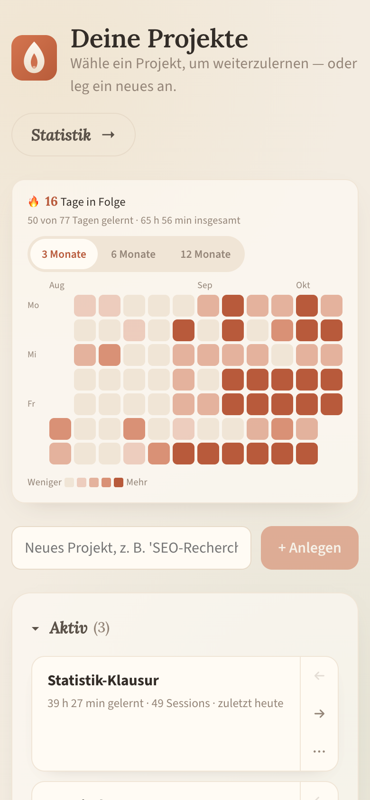
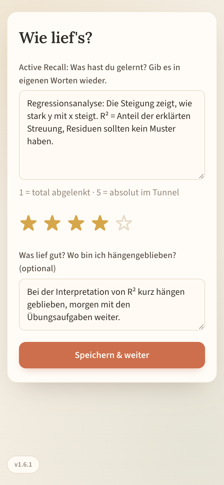
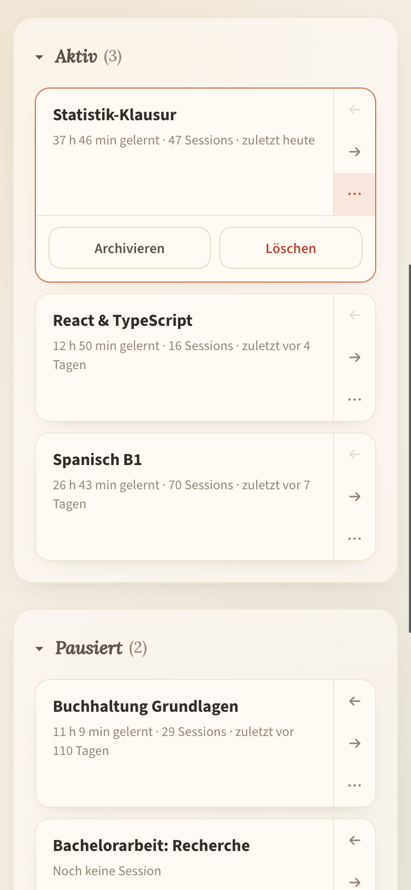
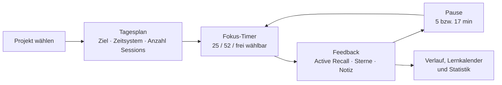
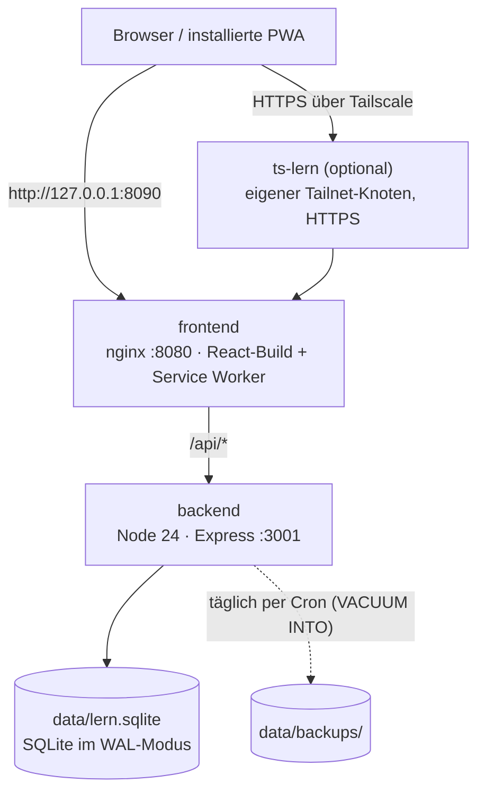

# Lern-PWA

[](https://github.com/Guppy997/lern-pwa/actions/workflows/ci.yml)


> **In short (English):** A self-hosted study tracker as an installable web app. Plan your day per study project, learn in timed focus sessions (25/5, 52/17 or custom), then write down what stuck (active recall) and rate your focus. Runs on your own hardware, no account, no tracking. The interface is in German.

**Lern-Sessions** ist ein selbst gehosteter Lern-Tracker als installierbare Web-App. Pro Lernprojekt planst du deinen Tag, lernst in festen Fokus-Phasen und hältst danach fest, was hängengeblieben ist. Läuft komplett auf eigener Hardware (bei mir ein Raspberry Pi 5), ohne Konto und ohne Tracking.


<table>
  <tr>
    <td align="center" width="33%"><br><sub>Startseite mit Lernkalender</sub></td>
    <td align="center" width="33%"><br><sub>Tagesplan und Verlauf</sub></td>
    <td align="center" width="33%"><br><sub>Fokus-Timer</sub></td>
  </tr>
  <tr>
    <td align="center"><br><sub>Feedback nach der Session</sub></td>
    <td align="center"><br><sub>Statistik</sub></td>
    <td align="center"><br><sub>Verschieben, archivieren, löschen</sub></td>
  </tr>
</table>

<sub>Screenshots mit Demo-Daten (siehe <a href="#mit-demo-daten-ausprobieren">Mit Demo-Daten ausprobieren</a>). Aktuelle Version: 1.6.2.</sub>

## Inhalt

- [Im Einsatz](#im-einsatz)
- [So funktioniert's](#so-funktionierts)
- [Funktionen](#funktionen)
- [Architektur](#architektur)
- [Sicherheit und Datenschutz](#sicherheit-und-datenschutz)
- [Selbst hosten](#selbst-hosten)
- [Backup und Wiederherstellung](#backup-und-wiederherstellung)
- [Entwicklung](#entwicklung)
- [Releases und Versionen](#releases-und-versionen)
- [Projektstruktur](#projektstruktur)
- [API](#api)
- [Datenmodell](#datenmodell)
- [Grenzen und Ideen](#grenzen-und-ideen)
- [Entstehung](#entstehung)
- [Lizenz](#lizenz)

## Im Einsatz

Die App läuft seit Version 1.0.0 im Juni 2026 auf meinem Raspberry Pi 5 und ist dort für mein eigenes Lernen in Benutzung. Archiv, Lernkalender mit Zeitraum-Filter und die Statistik nach Projekt und Bewertung sind aus dieser Nutzung entstanden.

## So funktioniert's



1. **Planen:** Für jedes Lernprojekt legst du fest, was heute dran ist, mit welchem Zeitsystem du lernst und wie viele Sessions du schaffen willst.
2. **Lernen:** Der Timer zählt die Fokuszeit herunter. Pausieren geht jederzeit, am Ende kommen Signalton und Benachrichtigung.
3. **Reflektieren:** Direkt danach schreibst du aus dem Kopf auf, was hängengeblieben ist (Active Recall), und bewertest, wie konzentriert du warst. Lernkalender und Statistik zeigen später, wann, wie lange, wofür und wie gut du gelernt hast.

## Funktionen

**Planen**
- **Projekt-Board** mit den Spalten Aktiv, Pausiert und Abgeschlossen. Projekte wandern mit ← → zwischen den Spalten, über ⋯ lassen sie sich archivieren oder löschen.
- Spalten lassen sich per Tipp auf die Überschrift einklappen. Die App merkt sich das pro Gerät.
- **Archiv:** Archivierte Projekte verschwinden vom Board, ihre Lernzeit zählt aber weiter in Lernkalender und Statistik. „Wiederherstellen“ bringt sie in ihre alte Spalte zurück.
- **Tagesplan pro Projekt:** Ziel für heute, Zeitsystem und Anzahl geplanter Sessions, mit Fortschrittsanzeige und abhakbar.

**Lernen**
- **Fokus-Timer** mit drei Zeitsystemen: 25/5 (Sprint), 52/17 (Deep Work) oder frei wählbar (5–180 min). Mit Pause/Weiter, Signalton und Browser-Benachrichtigung am Ende. Bei 25/5 und 52/17 startet nach dem Feedback automatisch der Pausen-Timer.
- Der Timer rechnet mit echten Zeitstempeln statt mitgezählten Sekunden. Er bleibt also korrekt, auch wenn der Browser den Tab drosselt oder das Handy schläft.
- **Offene Sessions:** Wird die App mitten in einer Session geschlossen, lässt sich die Session später fortsetzen oder verwerfen.

**Reflektieren**
- **Feedback nach jeder Session:** Active Recall (aus dem Kopf aufschreiben, was hängengeblieben ist), Bewertung von 1–5 Sternen und eine freie Notiz.
- **Verlauf** pro Projekt nach Kalendertag gruppiert, mit Tagesziel, geplant vs. geschafft und Details zu jeder Session.

**Überblick**
- **Lernkalender** im GitHub-Stil mit Lern-Serie in Tagen. Der Filter zeigt 3 Monate (Standard), 6 oder 12 Monate, und die App merkt sich die Wahl pro Gerät. Die Felder wachsen mit der verfügbaren Breite, ein Tipp zeigt die Details des Tages.
- **Statistik** nach Woche oder Monat, zum Durchblättern:
  - Fokuszeit pro Tag als Diagramm.
  - „Wofür du gelernt hast“: Lernzeit pro Projekt mit Anteil.
  - „Wie es lief“: Ø Sterne-Bewertung, auch nach Tageszeit.
- Gezählt wird nur aktive Timer-Zeit, also ohne Pausen und gedeckelt auf die geplante Dauer. Wer den Timer nach dem Ende liegen lässt, bekommt das nicht als Lernzeit gutgeschrieben.

**App**
- Als **PWA** auf Handy und Desktop installierbar.
- **Offline:** Ist der Server nicht erreichbar, zeigt die App den zuletzt bekannten Stand.
- **Updates:** Liegt eine neue Version auf dem Server, schwebt unten links „Update verfügbar“. Ein Tipp lädt sie. Die Versionsnummer selbst steht am Seitenende, ein Klick darauf öffnet den Versionsverlauf.

## Architektur



| Teil | Technik |
|---|---|
| Frontend | React 18, Vite 5, `vite-plugin-pwa` (Manifest, Service Worker, NetworkFirst-Cache für `GET /api/*`) |
| Backend | Node 24, Express 4, better-sqlite3. Kein ORM, alle Queries parametrisiert |
| Datenbank | SQLite im WAL-Modus, Foreign Keys an, Schema-Migrationen beim Start (`backend/src/db.js`) |
| Betrieb | Docker Compose, beide Container non-root, mit Healthchecks und Ressourcen-Limits |
| Zugriff | Tailscale-Sidecar mit eigenem Hostnamen und HTTPS-Zertifikat, oder lokal über `127.0.0.1:8090` |
| Tests und CI | Vitest und Supertest für die API, GitHub Actions mit Node 22 und 24, Dependabot |

Das Backend ist nie direkt erreichbar, nur über den nginx-Proxy im Frontend-Container. Dadurch laufen alle Anfragen über denselben Origin, und das Backend braucht kein CORS.

## Sicherheit und Datenschutz

- **Daten bleiben auf eigener Hardware:** Alles liegt in einer SQLite-Datei auf dem eigenen Server. Kein Konto, keine Cookies, keine Analyse-Tools.
- **Keine Anmeldung:** Die App ist für eine Person gebaut. Geschützt wird sie über das Netz: Der Port ist nur an `127.0.0.1` gebunden, von außen geht es nur über Tailscale.
- **Eine fremde Anfrage:** Die Schriften kommen noch von Google Fonts. Sonst spricht die App nur mit dem eigenen Server.
- **Backend abgeschirmt:** Erreichbar nur über den nginx-Proxy im Frontend-Container, nie direkt.
- **SQL** ausschließlich mit Platzhaltern, Eingaben werden serverseitig geprüft (zum Beispiel Bewertung 1–5, Fokuszeit höchstens die geplante Dauer).
- **Container** laufen ohne Root-Rechte (`node` bzw. `nginx-unprivileged`), mit Healthchecks und CPU- und RAM-Limits.
- **Abhängigkeiten:** Dependabot schlägt wöchentlich Updates für npm-Pakete und GitHub Actions vor, die CI testet jeden Push.

Sicherheitslücken bitte vertraulich melden, wie in [`SECURITY.md`](SECURITY.md) beschrieben.

## Selbst hosten

> [!WARNING]
> Die App hat **keine Anmeldung**. Wer sie im Browser erreicht, kann alle Daten lesen und löschen. Betreibe sie nur in einem privaten Netz oder hinter Tailscale/VPN, nie offen im Internet.

**Voraussetzungen:** Docker mit Compose-Plugin. Läuft auf arm64 (Raspberry Pi) und x86_64.

```bash
git clone https://github.com/Guppy997/lern-pwa.git
cd lern-pwa
mkdir -p data        # vorher anlegen, sonst legt Docker den Ordner als root an
docker compose up -d --build backend frontend
```

Die App läuft danach unter `http://127.0.0.1:8090`. Der Port ist absichtlich nur an localhost gebunden.

Der Backend-Container läuft als User `node` (UID 1000) und muss in `./data` schreiben dürfen. Gehört der Ordner einem anderen User, hilft `sudo chown 1000:1000 data`.

### Zugriff über Tailscale (optional)

Der Service `ts-lern` hängt die App als eigenen Knoten `lern-pwa` in dein Tailnet und stellt sie per HTTPS bereit (`https://lern-pwa.<dein-tailnet>.ts.net`). Ein echtes HTTPS-Zertifikat ist für die PWA-Installation auf dem Handy nötig.

1. In der Tailscale-Admin-Konsole einen Auth-Key mit dem Tag `tag:pwa-sidecar` erzeugen. Der Tag muss in den ACLs einen Owner haben.
2. Vorlage kopieren und den Key eintragen (`.env` ist in `.gitignore`):
   ```bash
   cp .env.example .env
   ```
3. Alles starten: `docker compose up -d --build`

Nach dem ersten Start merkt sich der Container seinen Zustand im Volume `ts-lern-state`, der Key wird danach nicht mehr gebraucht.

### Konfiguration

| Variable | Wo | Standard | Zweck |
|---|---|---|---|
| `TZ` | backend | `Europe/Berlin` (in Compose gesetzt) | Tagesgrenzen für Tagesplan, Verlauf und Statistik. Das Backend startet bewusst nicht, wenn sie anders gesetzt ist. |
| `DB_PATH` | backend | `/app/data/lern.sqlite` im Container, sonst `backend/data/lern.sqlite` | Pfad zur SQLite-Datei |
| `PORT` | backend | `3001` | Port des Backends im Container |
| `BACKUP_DIR` | backup.js | `<DB-Ordner>/backups` | Ziel für Backups |
| `BACKUP_KEEP_DAYS` | backup.js | `14` | Wie lange Backups behalten werden |
| `TS_AUTHKEY` | ts-lern | leer | Tailscale-Auth-Key für den Sidecar (siehe `.env.example`) |
| `VITE_API_PROXY_TARGET` | Vite (Entwicklung) | `http://localhost:3001` | Ziel für `/api` im Dev-Server |

## Backup und Wiederherstellung

`backend/src/backup.js` erzeugt mit `VACUUM INTO` einen konsistenten Snapshot der Datenbank. Anders als ein einfaches `cp` enthält er auch Änderungen, die noch in der WAL-Datei stehen. Backups landen in `data/backups/lern-YYYY-MM-DD.sqlite` und werden nach 14 Tagen gelöscht. Ein zweiter Lauf am selben Tag ersetzt die Tagessicherung.

Täglich per Cron, zum Beispiel um 03:30:

```cron
30 3 * * * cd /pfad/zu/lern-pwa && docker compose exec -T backend node src/backup.js >> backup.log 2>&1
```

Manuell: `docker compose exec backend node src/backup.js`

Die Backups liegen auf demselben Datenträger wie die Datenbank. Kopiere `data/backups/` regelmäßig zusätzlich auf ein anderes Gerät.

**Wiederherstellen:**

```bash
docker compose stop backend
cp data/backups/lern-2026-10-15.sqlite data/lern.sqlite
rm -f data/lern.sqlite-wal data/lern.sqlite-shm
docker compose start backend
```

## Entwicklung

Backend und Frontend laufen lokal ohne Docker (Node 22.12 oder neuer):

```bash
# Terminal 1: Backend auf :3001
cd backend
npm ci
mkdir -p data
TZ=Europe/Berlin npm start

# Terminal 2: Frontend mit Hot Reload auf :5173, /api wird an :3001 weitergereicht
cd frontend
npm ci
npm run dev
```

Zum Testen mit echten Daten ein Backup kopieren und das Backend darauf zeigen lassen: `DB_PATH=/pfad/zur/kopie.sqlite TZ=Europe/Berlin npm start`.

### Mit Demo-Daten ausprobieren

`scripts/seed-demo.mjs` legt eine Datenbank mit acht ausgedachten Projekten und gut 200 Sessions über das letzte Jahr an, inklusive Tagesplan für heute und einer Lern-Serie. Das Skript schreibt nur in eine leere Datei und bricht ab, wenn dort schon Projekte stehen.

```bash
cd backend && npm ci && cd ..
node scripts/seed-demo.mjs                                  # → backend/data/demo.sqlite
cd backend && DB_PATH=data/demo.sqlite TZ=Europe/Berlin npm start
```

### Screenshots aktualisieren

Die Bilder in dieser README erzeugt `scripts/readme-screenshots.mjs` per headless Chrome, ohne zusätzliche Pakete. Backend mit Demo-Daten und Frontend-Dev-Server müssen laufen:

```bash
node scripts/readme-screenshots.mjs                         # → docs/screenshots/
```

Andere Adresse oder Chrome-Pfad über `APP_URL` bzw. `CHROME_PATH`. Zur Sicherheit läuft das Skript nur, wenn die App die Demo-Daten zeigt. Die Session, die es für Timer und Feedback startet, verwirft es am Ende wieder.

### Tests

```bash
cd backend
npm test
```

16 API-Tests mit Vitest und Supertest. Sie laufen gegen eine Datenbank im Arbeitsspeicher und berühren nie echte Daten. Abgedeckt sind Projekte (anlegen, verschieben, archivieren, wiederherstellen, löschen), Tagesplan, Sessions mit Feedback samt Grenzen für Fokuszeit, Pause und Bewertung sowie die Statistik-Zeiträume.

Die CI auf GitHub Actions führt bei jedem Push und Pull Request die Tests mit Node 22 und 24 aus und baut das Frontend.

### Konventionen im Code

- Kommentare auf Deutsch und eher zum *Warum* als zum *Was*.
- Schemaänderungen nur additiv über `addColumnIfMissing` in `db.js`, damit bestehende Datenbanken beim nächsten Start mitwachsen.
- Zeitstempel speichert SQLite in UTC (`datetime('now')`). Im Frontend immer über `parseDbDate` aus `constants.js` lesen.
- Einstellungen pro Gerät (eingeklappte Spalten, Kalender-Zeitraum) liegen in `localStorage` und sind immer in `try/catch` gekapselt. Ohne Speicher gilt einfach der Standard.

## Releases und Versionen

Die App hat eine eigene Versionsnummer mit Versionsverlauf. Für ein sichtbares Release:

1. In `frontend/src/changelog.js` oben einen Eintrag ergänzen und `APP_VERSION` hochzählen.
2. Dieselbe Version in `frontend/package.json` und `backend/package.json` eintragen.
3. In dieser README die Tabelle unten und die Versionszeile unter den Screenshots anpassen.
4. Deployen: `git pull && docker compose up -d --build backend frontend`

Installierte Apps erkennen die neue Version beim Öffnen, beim Zurückholen in den Vordergrund und stündlich, und zeigen dann „Update verfügbar“. Reine Server-Änderungen ohne neues Frontend lösen keinen Hinweis aus.

| Version | Datum | Wichtigste Änderungen |
|---|---|---|
| **1.6.2** | 16.10.2026 | Überschriften-Check entfernt, der Timer ist jetzt schlichter |
| 1.6.1 | 16.10.2026 | Statistik unten ruhiger und aufgeräumter, gleiche Breite in Wochen- und Monatsansicht |
| 1.6.0 | 16.10.2026 | Lernkalender mit Zeitraum-Filter (3/6/12 Monate) und größeren Feldern; Statistik nach Projekt und Bewertung |
| 1.5.2 | 16.10.2026 | Versionsnummer am Seitenende statt schwebend über dem Inhalt |
| 1.5.0–1.5.1 | 16.10.2026 | Archiv, einklappbare Spalten, ⋯-Menü zum Archivieren und Löschen, „zuletzt gelernt“ auf den Karten |
| 1.4.1 | 16.10.2026 | Update-Hinweis auch bei lange offener App; Server auf Node 24, reproduzierbare Builds |
| 1.4.0 | 07.07.2026 | Mobile-Optimierung: weniger Rand, größere Tipp-Ziele |
| 1.2–1.3 | 06.07.2026 | Lernkalender im GitHub-Stil mit Lern-Serie; Statistik zum Durchblättern |
| 1.1.0 | 04.07.2026 | Offline-Modus, Update-Button und Versionsverlauf |
| 1.0.0 | 13.06.2026 | Erste Version: Tagesplan, Fokus-Timer, Active Recall, Verlauf nach Kalendertag |

Alle Einzelheiten stehen im Versionsverlauf der App (Klick auf die Versionsnummer) bzw. in [`frontend/src/changelog.js`](frontend/src/changelog.js).

## Projektstruktur

```
.
├── .github/
│   ├── workflows/ci.yml       Tests und Build bei jedem Push (Node 22 und 24)
│   └── dependabot.yml         Wöchentliche Updates für npm und GitHub Actions
├── backend/
│   ├── Dockerfile
│   ├── vitest.config.js       Testumgebung: TZ Europe/Berlin, Datenbank im Arbeitsspeicher
│   ├── src/
│   │   ├── index.js           Startpunkt: TZ-Check, Server starten
│   │   ├── app.js             Express-App mit Routen und zentraler Fehlerbehandlung
│   │   ├── db.js              Verbindung, Schema, Migrationen, WAL-Checkpoints
│   │   ├── backup.js          Backup-Skript (VACUUM INTO + Rotation)
│   │   └── routes/            projects.js, sessions.js, stats.js
│   └── test/api.test.js       API-Tests
├── frontend/
│   ├── Dockerfile, nginx.conf
│   ├── vite.config.js         PWA-Manifest, Service Worker, Offline-Cache
│   └── src/
│       ├── App.jsx            Ablauf: Board → Projekt → Timer → Feedback → Pause
│       ├── api.js             Fetch-Wrapper mit deutschen Fehlermeldungen
│       ├── constants.js       Zeitsysteme, Datumshilfen, Signalton, Benachrichtigungen
│       ├── changelog.js       Version und Versionsverlauf
│       └── components/        Board, Projekt-Dashboard, Timer, Feedback, Statistik, Lernkalender
├── scripts/
│   ├── seed-demo.mjs          Demo-Datenbank zum Ausprobieren
│   └── readme-screenshots.mjs Screenshots für diese README
├── docs/screenshots/
├── docker-compose.yml
├── ts-serve.json              tailscale-serve-Konfiguration für den Sidecar
├── .env.example               Vorlage für den Tailscale-Auth-Key
└── SECURITY.md                Sicherheitslücken vertraulich melden
```

## API

Alle Endpunkte liegen unter `/api` und sprechen JSON. Fehler kommen als `{ "error": "…" }` mit passendem Statuscode zurück.

| Methode | Pfad | Zweck |
|---|---|---|
| `GET` | `/health` | Healthcheck |
| `GET` | `/projects` | Alle Projekte inkl. Fokuszeit, Session-Anzahl, letzter Aktivität |
| `POST` | `/projects` | Projekt anlegen: `{ name }` |
| `PATCH` | `/projects/:id` | Spalte wechseln und/oder archivieren: `{ status?: "active" \| "paused" \| "done", archived?: boolean }` |
| `DELETE` | `/projects/:id` | Projekt samt Tagesplänen und Sessions löschen |
| `GET` | `/projects/:id` | Projekt mit heutigem Plan, allen Tagesplänen, Sessions und Summen |
| `POST` | `/projects/:id/day-plan` | Heutigen Plan anlegen oder ersetzen: `{ goal, method, plannedSessions }` |
| `PATCH` | `/projects/:id/day-plan` | Heutigen Plan abhaken oder wieder öffnen: `{ completed }` |
| `POST` | `/sessions` | Session starten: `{ projectId, dayPlanId?, plannedMinutes }` |
| `PATCH` | `/sessions/:id` | Session mit Feedback abschließen: `{ focusSeconds, pausedSeconds, efficiencyRating, recallText, feedbackNote }` |
| `DELETE` | `/sessions/:id` | Laufende Session verwerfen oder aus dem Verlauf löschen |
| `GET` | `/stats?period=week\|month&offset=0` | Fokuszeit pro Tag (`days`) plus `projects` (Lernzeit pro Projekt) und `rating` (Ø Bewertung, `byDaytime`). `offset=-1` ist die vorherige Woche bzw. der vorherige Monat |
| `GET` | `/stats?period=lastMonths&months=12` | Dasselbe für den Lernkalender: vom 1. des Monats vor `months − 1` Monaten bis heute (1–12) |

## Datenmodell

| Tabelle | Wichtige Spalten |
|---|---|
| `projects` | `name` (eindeutig), `status` (`active`/`paused`/`done`), `archived_at` |
| `day_plans` | `project_id`, `date` (lokales Datum, eindeutig pro Projekt), `goal`, `method` (`sprint`, `deep` oder `free:<Minuten>`), `planned_sessions`, `completed_at` |
| `sessions` | `project_id`, `day_plan_id`, `planned_minutes`, `started_at`, `ended_at` (leer = offene Session), `focus_seconds`, `paused_seconds`, `efficiency_rating`, `recall_text`, `feedback_note`. Dazu `method_data` aus dem früheren Überschriften-Check (seit v1.6.2 ungenutzt, bleibt für alte Datenbanken bestehen) |

## Grenzen und Ideen

**Bekannte Grenzen**
- Für eine Person gebaut: keine Konten, keine Anmeldung, keine Synchronisation zwischen mehreren Nutzern.
- Oberfläche nur auf Deutsch, Zeitzone fest auf `Europe/Berlin`.
- Auf Android kommt die Benachrichtigung am Timer-Ende nicht zuverlässig an: Chrome erlaubt dort kein `new Notification()`, und bei gesperrtem Bildschirm pausiert die Seite samt Timer-Ton.
- Die Schriften (Lora, Source Sans 3) kommen noch von Google Fonts. Das ist die einzige Anfrage an einen fremden Server.
- Automatisierte Tests gibt es für die API, noch nicht für die Oberfläche.

**Ideen**
- Timer-Ende per Web Push vom Server melden, damit es auch bei gesperrtem Handy ankommt.
- Schriften selbst ausliefern statt über Google Fonts.
- Beim Öffnen eines Projekts das Recall und den nächsten Schritt der letzten Session anzeigen.
- Tagesplan automatisch abhaken, wenn alle geplanten Sessions geschafft sind.
- Bewertungen zusätzlich nach Session-Länge auswerten (25 vs. 52 Minuten).

## Entstehung

Entwickelt mit KI-Unterstützung (Claude). Idee, Architektur, Anforderungen, Tests und Betrieb liegen bei mir; jede Änderung ist geprüft und versioniert.

## Lizenz

[MIT](LICENSE). Du darfst den Code frei nutzen, verändern und weitergeben, solange der Lizenzhinweis erhalten bleibt.
